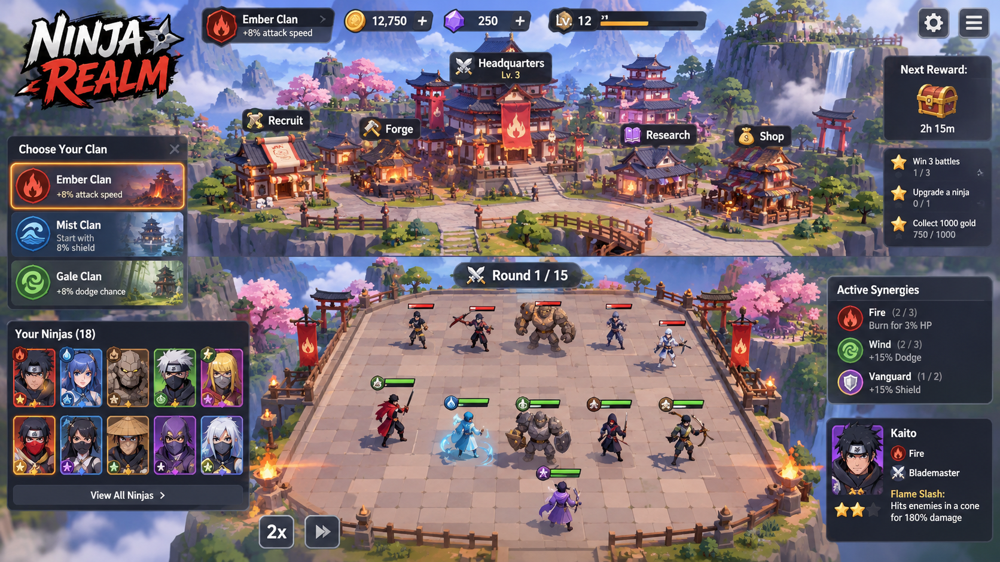

# Ninja Realm art style

`art/style-reference.png` is the target look. Every model, texture and icon should look like it belongs in that picture.

## The look in one line

Stylized, hand-painted, warm feudal Japan fantasy, like a polished mobile strategy game. Shapes are simple and chunky, and detail is painted into the texture, not modelled.

## Characters

* Slightly chibi proportions, about 3 to 4 heads tall, with big readable heads and hands.
* A clean silhouette that reads from the angled board camera. Class shows through silhouette and weapon: a Vanguard is bulky with a shield, an Assassin is lean with daggers, a Marksman carries a bow.
* Dark cloth, plus one strong accent colour for the element:

| Element | Accent colour |
| --- | --- |
| Fire | Red and orange |
| Water | Blue and cyan |
| Wind | Green |
| Earth | Brown and stone grey |
| Lightning | Purple and violet |

* Modelled in a T pose or A pose, facing front, so auto-rigging works.
* Budget: about 5,000 to 10,000 triangles per character.

## Buildings and environment

* Japanese village architecture: curved dark-blue tiled roofs, red lacquered wood, paper lanterns, cloth banners with the clan emblem.
* Slightly exaggerated, chunky proportions with thick shapes.
* Nature: cherry blossom trees with round pink canopies, rounded pines, cliffs, waterfalls, torii gates.
* Arena: stone-tile board with wooden fences, braziers and clan banners.
* Budget: about 2,000 to 10,000 triangles per building or prop.

## Lighting and colour

* Lighting comes from the Unity scene (URP), not from the textures. Avoid baked-in shadows or strong highlights in textures.
* Warm sunset key light with soft, cooler shadows.
* Colours are saturated but not neon. Lanterns, fire and skills glow.

## UI

* Dark slate panels with rounded corners and thin light borders.
* Bold, heavy display font for titles. Clean sans serif for body text.
* Round element and class badges in the element colour.
* Gold for currency and rewards, purple for gems.

## Meshy workflow

Add this style text to the end of every Meshy prompt:

> stylized hand-painted game asset, chunky simple shapes, clean silhouette, warm saturated colors, soft painted texture, feudal Japan ninja fantasy, mobile strategy game style, no text

Example prompts:

* **Ninja:** "chibi ninja warrior, 3.5 heads tall, red scarf, fire element, dark outfit, katana on back, T-pose, front view, " + style text
* **Building:** "Japanese forge building, curved blue tile roof, red wood pillars, glowing furnace, lanterns, " + style text
* **Prop:** "cherry blossom tree, round pink canopy, " + style text

How to use it:

1. **Characters:** first make a clean full-body front view image of the ninja (Meshy text-to-image, using the reference as a style guide). Then use Image to 3D, which matches the style much better than text alone. Then rig it in Meshy and save the rigged FBX as the character's model. Meshy only gives rigged models and animations as links: list them in `Logs/meshy/downloads.txt` (a project path, a tab, then the link, one file per line) and run **Ninja Realm > Art > Download Meshy Files**.
2. **Animations:** every ninja shares one set of humanoid clips. Animate one rigged ninja in Meshy and save each clip as `Assets/_Project/Art/Meshy/Animations/<Clip>.fbx`: `Idle` and `Run` (looping), `Attack`, `Cast`, `Hit` and `Death`. Unity plays them on any rigged ninja.
3. **Buildings and props:** text-to-3D or image-to-3D, with the same style text.
4. **Keep it consistent:** use Meshy's retexture with `art/style-reference.png`, or with an approved model's texture, as the style image.
5. **Import:** save each model as FBX to `Assets/_Project/Art/Meshy/<Characters|Buildings|Props>/<Name>/<Name>.fbx`, with Meshy's `<Name>_base_color.png` next to it (the Meshy download tool does this). `MeshyArtImporter` then gives it a matte URP Lit material with that texture, with no manual setup. Rigged characters and the clips import as Humanoid.
6. **Check it:** **Ninja Realm > Art > Open Meshy Showcase** lines up every Meshy model at game scale (ninjas 1.2 m, props 3 m, buildings 4.5 m) in the board lighting. Check the triangle count and pose there.
7. **Put ninjas in fights:** **Ninja Realm > Art > Set Up Ninja Models** builds `Animations/NinjaAnimator.controller` from the clips, saves a `<Name>.prefab` next to each ninja's model with that controller, and sets it as the ninja's model. Fights then show the model instead of the placeholder. Run it again after adding a ninja or a clip.

8. **Dress the battle board:** save props to `Props/<Name>/` and buildings to `Buildings/<Name>/` as in step 5, and the tile and ground textures to `Assets/_Project/Art/Arena/StoneTile.png` and `Grass.png` (the grass must tile seamlessly). **Ninja Realm > Art > Set Up Battle Arena** then builds `Art/Arena/BattleArena.prefab` from the layout in `BattleArenaSetup` (each model fitted to its size and stood on the ground), links the prefab and textures to the board in `Battle.unity`, and sets the battle camera. Models that are missing are left out, so run it again after adding one. To move things around, change the layout in `BattleArenaSetup` and run it again, since the prefab is rebuilt each time.

Arena models so far: Fence, Brazier, Banner, StoneLantern, PineTree, Rocks and CherryTree (props), and ToriiGate, VillageHouse, Watchtower and Forge (buildings). Each was made as a Meshy text-to-image concept with the style text, then image-to-3D with smart topology (`meshy-t2`, 3,000 to 8,000 polygons) and the `meshy-n1` texture.

Art files (`.png`, `.fbx`, `.glb` and others) are stored with Git LFS, so Git LFS must be installed on any machine that clones the repo.
